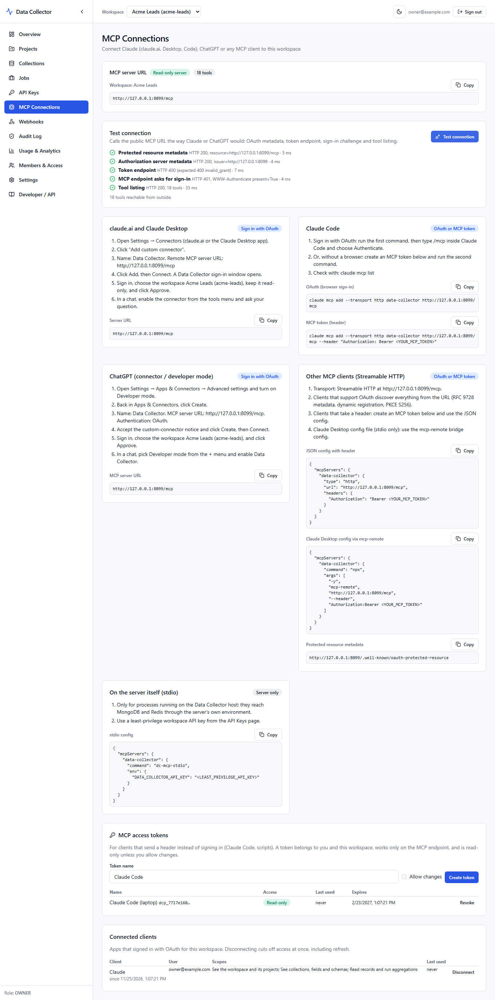
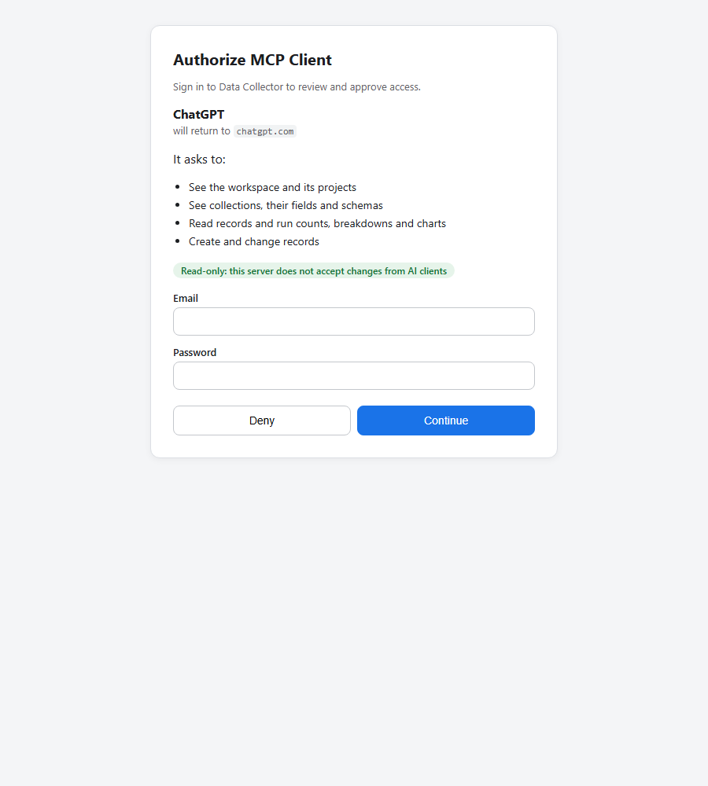
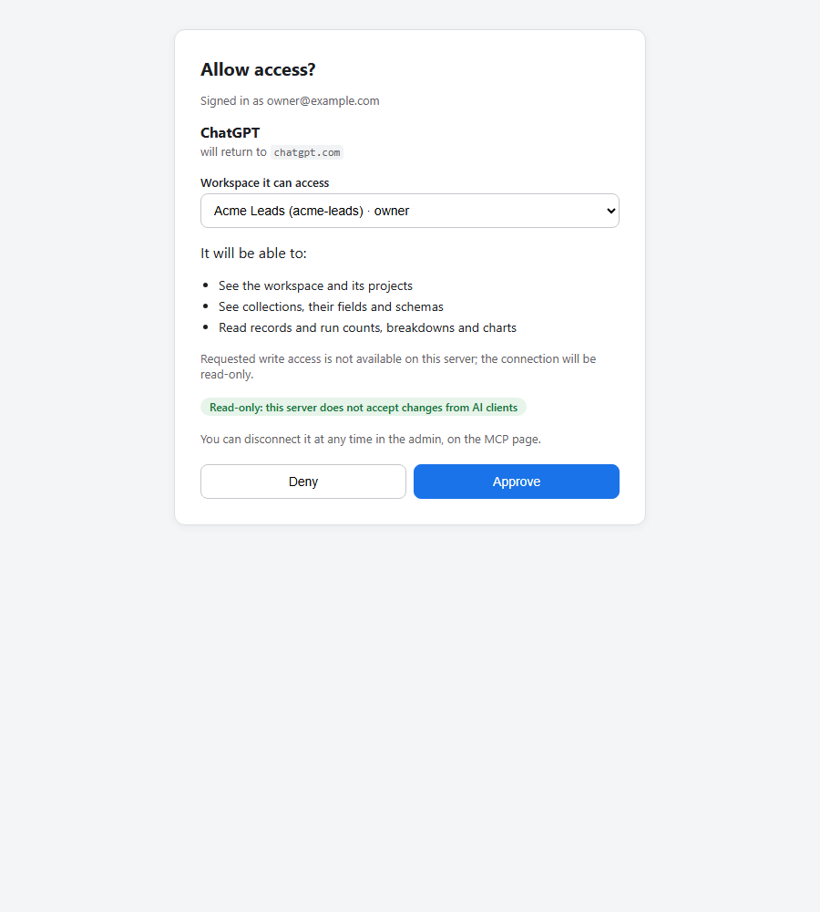

# Connecting Claude and ChatGPT to Data Collector (MCP)

The quickest path: open the admin → **MCP Connections**. Every URL, command and config
there is built from the server's own settings (`MCP_PUBLIC_URL`, the workspace), so you
copy one block, paste it into the client, sign in once and pick the workspace.



MCP endpoint: `<MCP_PUBLIC_URL>`, e.g. `https://data.devart.solutions/mcp` (Streamable HTTP).

## Clients

| Client | How it signs in | What to paste |
|---|---|---|
| claude.ai, Claude Desktop | OAuth (browser) | Settings → Connectors → *Add custom connector* → URL |
| Claude Code | OAuth, or an MCP token | `claude mcp add --transport http data-collector <URL>` then `/mcp` → Authenticate; or add `--header "Authorization: Bearer dcp_…"` |
| ChatGPT | OAuth (browser) | Settings → Apps & Connectors → Advanced → Developer mode on → *Create* → URL, Authentication: OAuth |
| Other MCP clients | OAuth discovery, or an MCP token header | `{"mcpServers": {"data-collector": {"type": "http", "url": "<URL>", "headers": {"Authorization": "Bearer dcp_…"}}}}` |
| A process on the server itself | workspace API key | `dc-mcp-stdio` with `DATA_COLLECTOR_API_KEY` (it uses the server's own MongoDB/Redis) |

**Test connection** on the MCP page calls the public URL the way a client does: protected
resource metadata, authorization server metadata, token endpoint, the unauthenticated
`401` challenge, and `tools/list` with a 60-second read-only probe token.

## Signing in (OAuth 2.1)

Discovery: `401` from `/mcp` carries
`WWW-Authenticate: Bearer resource_metadata="…/.well-known/oauth-protected-resource", scope="workspace:read collection:read records:read"`.
Metadata is also served at the RFC 9728 path form `/.well-known/oauth-protected-resource/mcp`.
Clients register themselves (dynamic client registration, public client, PKCE S256).
Redirect URIs must be `https`, or `http` on a loopback address (any port, RFC 8252) for
native clients such as Claude Code. Unknown scopes such as `openid` or `offline_access` are ignored.

The user signs in, then sees the consent screen: client name, where it returns to, the
**workspace** it may access, the scopes in plain words, and whether it is read-only.

| Sign in | Consent |
|---|---|
|  |  |

- The grant is bound to the chosen workspace (`wid` claim, kept on refresh); the client
  cannot see the user's other workspaces.
- Write scopes are granted only if the user ticks *Also allow it to…* **and** the server
  runs with `MCP_ALLOW_WRITES=true`; otherwise they are dropped.
- Connected clients are listed on the MCP page (last use, scopes) and can be disconnected;
  that revokes access and refresh tokens at once.

## MCP access tokens (no browser)

For header-based clients: MCP page → *MCP access tokens* → **Create token**. The token
(`dcp_…`) is shown once, belongs to you and one workspace, is read-only unless you allow
changes (and the server allows writes), and is capped by your role.

- `/mcp` accepts it as `Authorization: Bearer dcp_…`. The REST API rejects it.
- Workspace API keys (`dc_…`) are **not** accepted as Bearer tokens on `/mcp`; you get an
  explicit error pointing here. They are ingest credentials, often with `records:write`,
  and should not double as AI credentials. (`X-API-Key` on `/mcp` is still accepted for
  existing setups.)

## Asking analytical questions

The server's instructions teach models this workflow:

1. `dc_list_workspaces` → `dc_list_projects` → `dc_list_collections`
2. `dc_describe_collection`: field paths (nested ones dotted, e.g. `dc_event.observed_at`), observed types, fill rates, groupable fields
3. `dc_distinct_values`: actual values of a field (e.g. `TX` vs `Texas`)
4. `dc_aggregate`: group_by ≤ 3 fields, metrics `count`, `count(field)`, `fill_rate`, `count_distinct`, `sum`, `avg`, `min`, `max`, `p50`; `filter` (safe DSL), `having`, `sort`, `limit` ≤ 500
5. `dc_histogram`: counts per day / ISO week / month over `created_at` or a date field

Example: *dentists per state that have an email but no website*

```json
{"collection_id": "…", "group_by": ["region"],
 "filter": {"and": [{"field": "categories", "op": "eq", "value": "dentist"},
                    {"field": "email", "op": "exists", "value": true},
                    {"field": "has_website", "op": "eq", "value": false}]}}
```

Every answer includes `coverage`: records matched, records where a grouped field is
missing/null/empty ("unknown"; a missing value never counts as `false`), and the
`created_at` range. Queries run server-side with a time budget (`ANALYTICS_MAX_TIME_MS`,
default 15 s) and no disk spill; an over-broad query returns `QUERY_TOO_BROAD`. The admin
**Usage & Analytics** page uses the same engine, so the numbers match.

## Auditing

Every MCP tool call writes an `mcp.tool_call` audit event with the user, the credential
kind (`oauth`, `mcp_pat`, `api_key`), the OAuth client id or token id, and the target ids.
Consent (`oauth.grant`), disconnects, token creation/revocation and connection checks are
audited too.

## Writes and deletes

Off by default. With `MCP_ALLOW_WRITES=true` and a write-enabled grant or token, models
can create/update records; deleting a record needs `dc_prepare_delete_record` and then
`dc_delete_record` with the returned one-time token. Collections cannot be deleted over MCP.
